# Merhaba, ben Enis Korkut 👋

### AI Engineer | LLM & RAG Systems | Multi-Agent Orchestration | Machine Learning

Bilgisayar mühendisiyim. **Büyük dil modelleri (LLM), yapay zekâ ajanları, RAG sistemleri ve uygulamalı makine öğrenmesi** üzerine çalışıyorum.

Yapay zekâyı yalnızca bir API üzerinden kullanmak yerine; veri işleme, retrieval, model değerlendirme, ajan koordinasyonu, gözlemlenebilirlik ve otomasyon süreçlerini kapsayan uçtan uca sistemler geliştiriyorum.

*Building reliable AI systems, intelligent developer tools and practical ML applications.*

---

## Teknoloji yığınım

**Languages & Backend**

**Frontend**

**Data & AI Infrastructure**

**AI & Machine Learning**

`RAG` · `LLM` · `MCP` · `Multi-Agent Systems` · `AWS Bedrock` · `OpenTelemetry`

---

## Öne çıkan açık kaynak projelerim

<table width="100%" border="0" cellspacing="0" cellpadding="8">
<tr>
<td width="50%" valign="top">
<a href="https://github.com/eniskorkut/auto-orchestrator">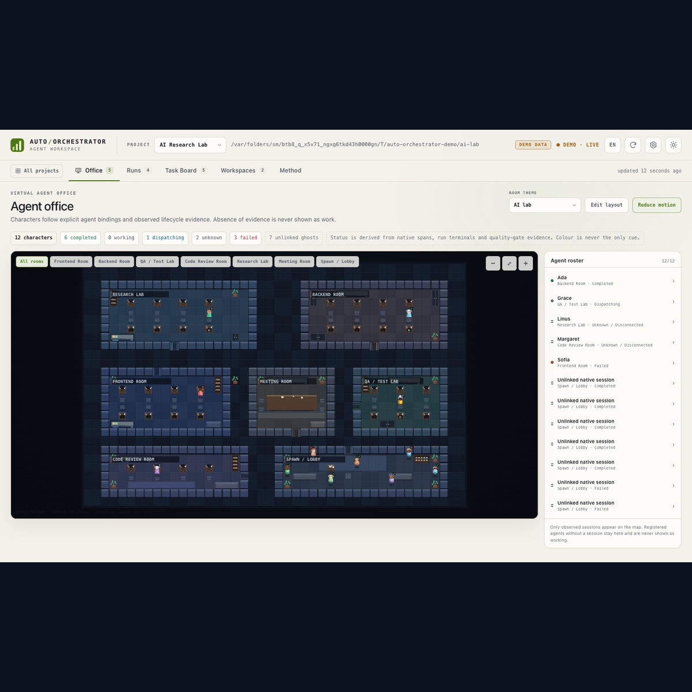</a>
<h3>Auto-Orchestrator</h3>

Kod geliştirme ajanlarının birlikte ve kontrollü çalışmasını sağlayan yerel orkestrasyon altyapısı.

<ul>
<li>Codex, OpenCode V2, Cursor ve Antigravity entegrasyonları.</li>
<li>Teamwork, Grill-Me ve milestone tabanlı görev planlama.</li>
<li>Verified Completion ve doğrulama dashboard'u.</li>
</ul>

<code>Python</code> · <code>SQLite</code> · <code>GitHub Actions</code>

<a href="https://github.com/eniskorkut/auto-orchestrator"><strong>GitHub →</strong></a>

</td>
<td width="50%" valign="top">
<a href="https://github.com/eniskorkut/bugrecall">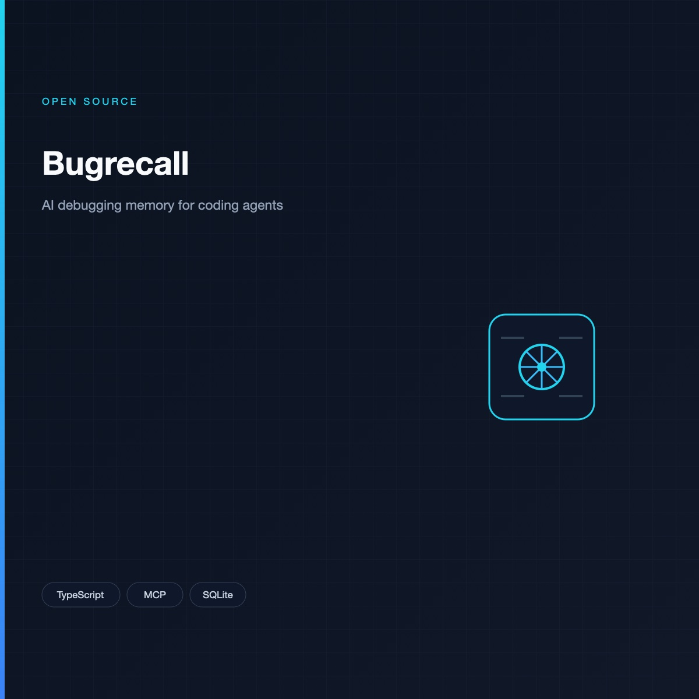</a>
<h3>Bugrecall</h3>

Yapay zekâ kodlama ajanlarına proje bazlı hata ayıklama hafızası kazandıran local-first MCP sistemi.

<ul>
<li>Tekrarlanan hataları ve doğrulanmış çözümleri hatırlar.</li>
<li>Reddedilmiş düzeltme yöntemlerini saklar.</li>
<li>Hataları imzalara göre sınıflandırır.</li>
</ul>

<code>TypeScript</code> · <code>MCP</code> · <code>SQLite</code>

<a href="https://github.com/eniskorkut/bugrecall"><strong>GitHub →</strong></a>

</td>
</tr>
<tr>
<td width="50%" valign="top">
<a href="https://github.com/eniskorkut/job-finder">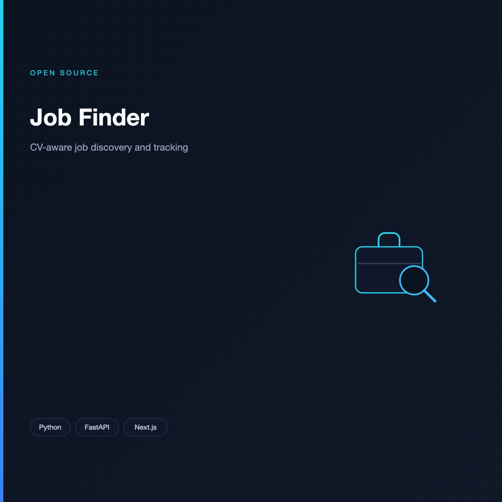</a>
<h3>Job Finder</h3>

İş ilanlarını kullanıcıların CV'leri ve tercihleriyle eşleştiren, yapay zekâ destekli iş arama ve takip uygulaması.

<ul>
<li>Gmail ve Outlook üzerinden ilan toplama.</li>
<li>LLM destekli CV ve ilan uygunluk değerlendirmesi.</li>
<li>SearXNG keşfi, Telegram bildirimleri ve otomatik tarama.</li>
</ul>

<code>Python</code> · <code>FastAPI</code> · <code>Next.js</code>

<a href="https://github.com/eniskorkut/job-finder"><strong>GitHub →</strong></a>

</td>
<td width="50%" valign="top">
<a href="https://github.com/eniskorkut/bist-research">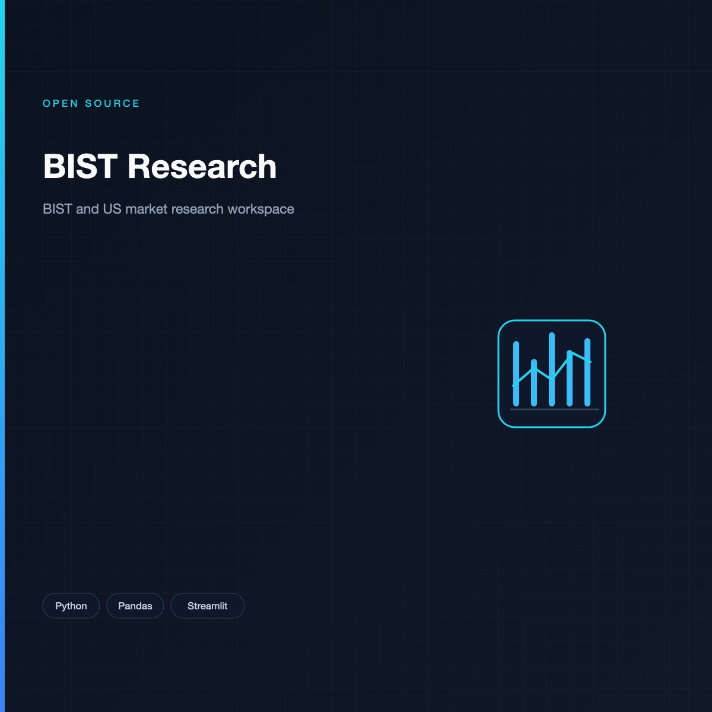</a>
<h3>BIST Research</h3>

Borsa İstanbul ve ABD piyasaları için veri toplama, şirket değerleme ve araştırma araçlarını birleştiren finansal analiz ortamı.

<ul>
<li>BIST hisselerinde hacim ve piyasa ilgisi analizi.</li>
<li>Çok yöntemli şirket değerleme ve sektör karşılaştırması.</li>
<li>OpenBB, SEC EDGAR ve MCP tabanlı araştırma.</li>
</ul>

<code>Python</code> · <code>Pandas</code> · <code>Streamlit</code>

<a href="https://github.com/eniskorkut/bist-research"><strong>GitHub →</strong></a>

</td>
</tr>
<tr>
<td width="50%" valign="top">
<a href="https://github.com/eniskorkut/toplant-ozeti">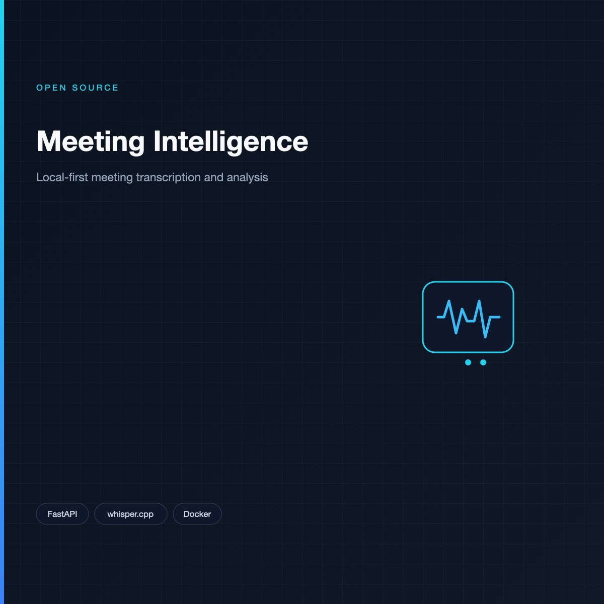</a>
<h3>Meeting Intelligence</h3>

Yerel öncelikli toplantı transkripsiyonu, konuşmacı ayrıştırma ve toplantı analizi için web uygulaması.

<ul>
<li>Tarayıcı tabanlı ses kaydı ve yükleme akışı.</li>
<li>FastAPI + ffmpeg + whisper.cpp + sherpa-onnx.</li>
<li>Linux Docker container'da tekrarlanabilir backend.</li>
</ul>

<code>Python</code> · <code>FastAPI</code> · <code>Docker</code>

<a href="https://github.com/eniskorkut/toplant-ozeti"><strong>GitHub →</strong></a> · <code>audio pipeline ready; analysis in progress</code>

</td>
<td width="50%" valign="top"></td>
</tr>
</table>

---

## Kişisel araştırma ve geliştirme projelerim

*Aşağıdaki projelerin kaynak kodları şu anda herkese açık değil.*

<table width="100%" border="0" cellspacing="0" cellpadding="8">
<tr>
<td width="50%" valign="top">
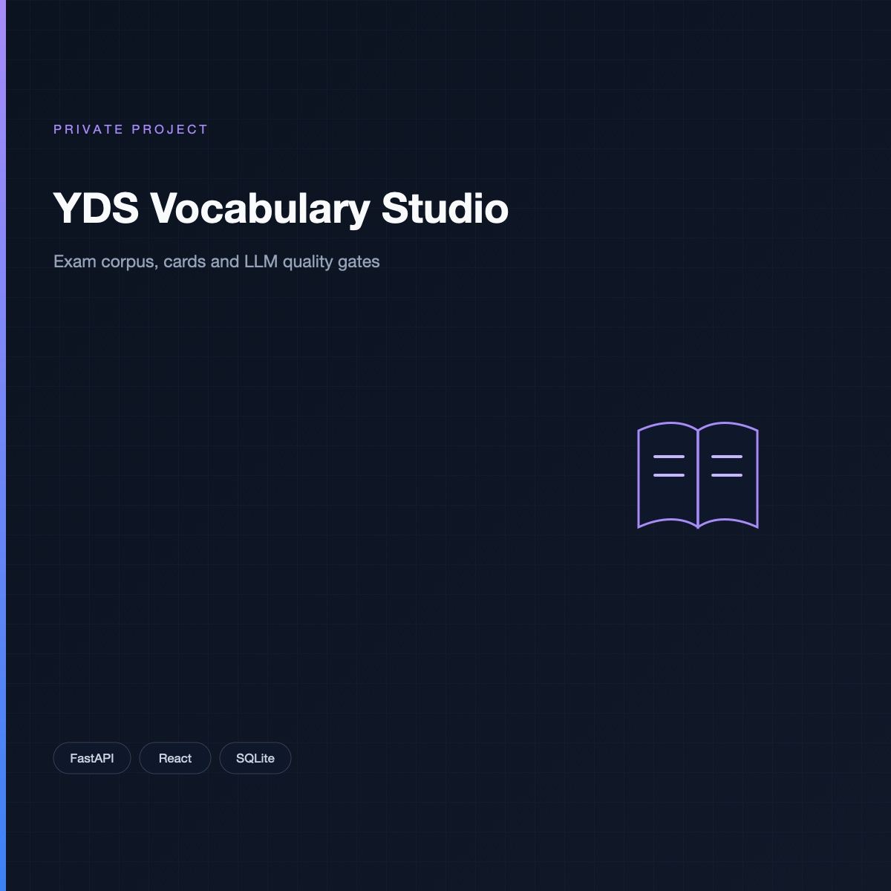
<h3>YDS Vocabulary Studio <code>Private Project</code></h3>

Gerçek sınav verileri üzerinden kelime öğrenimi, içerik üretimi ve kalite değerlendirmesi sağlayan AI destekli eğitim uygulaması.

<ul>
<li>110 sınav kitapçığı ve yaklaşık 630 bin kelime geçişi.</li>
<li>15.876 sınav cümlesi ve 3.881 kelime kartı.</li>
<li>OCR ile taranmış kitapçık işleme ve bağımsız LLM Judge.</li>
</ul>

<code>FastAPI</code> · <code>React</code> · <code>SQLite</code> · <code>FTS5</code>

</td>
<td width="50%" valign="top">
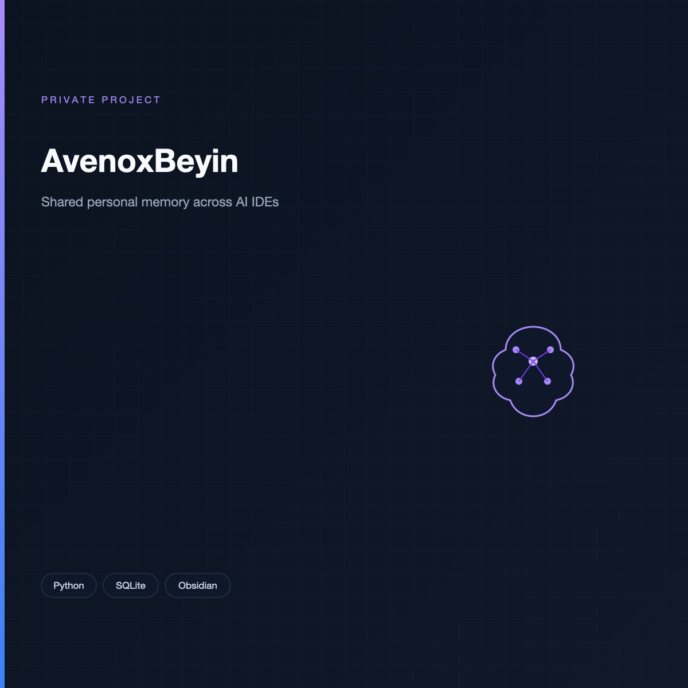
<h3>AvenoxBeyin <code>Private Project</code></h3>

Obsidian tabanlı kişisel bilgi yönetimi ve geliştirici hafızası sistemi.

<ul>
<li>Codex, OpenCode ve Antigravity arasında ortak bilgi yapısı.</li>
<li>Markdown kaydı ve SQLite ile yerel indeksleme.</li>
<li>Proje kararlarının ve bağlamının korunması.</li>
</ul>

<code>Python</code> · <code>SQLite</code> · <code>Obsidian</code> · <code>Git</code>

</td>
</tr>
<tr>
<td width="50%" valign="top">
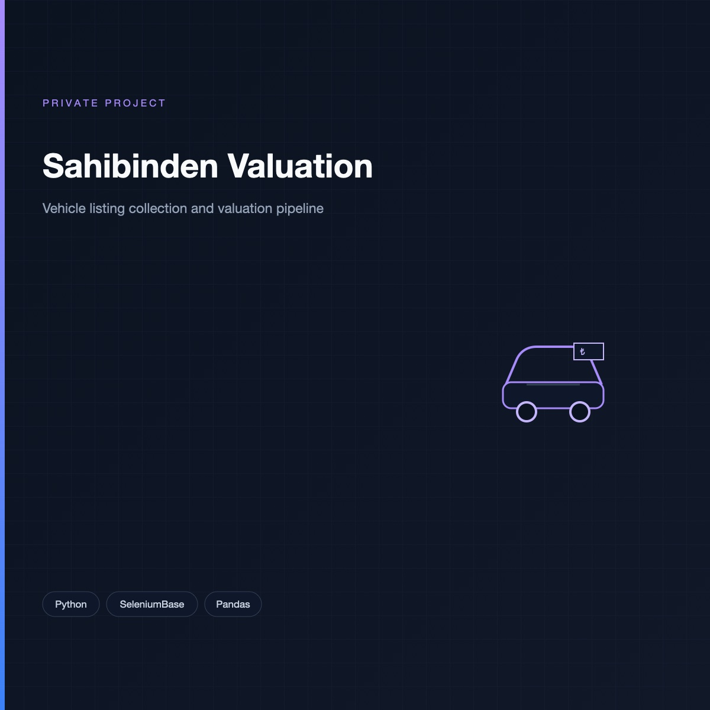
<h3>Sahibinden Vehicle Valuation <code>Private Project</code></h3>

Sahibinden ilanlarından araç verisi toplayan, Cloudflare ve CAPTCHA korumasını aşmak için üç farklı yöntem destekleyen araç seti.

<ul>
<li>Marka, model, yıl ve kilometre filtreleriyle ilan toplama.</li>
<li>SeleniumBase UC Mode, proxy ve IP yenileme seçenekleri.</li>
<li>CSV/Excel çıktısı ve kısa süreli arama önbelleği.</li>
</ul>

<code>Python</code> · <code>SeleniumBase</code> · <code>FastAPI</code> · <code>Pandas</code>

</td>
<td width="50%" valign="top">
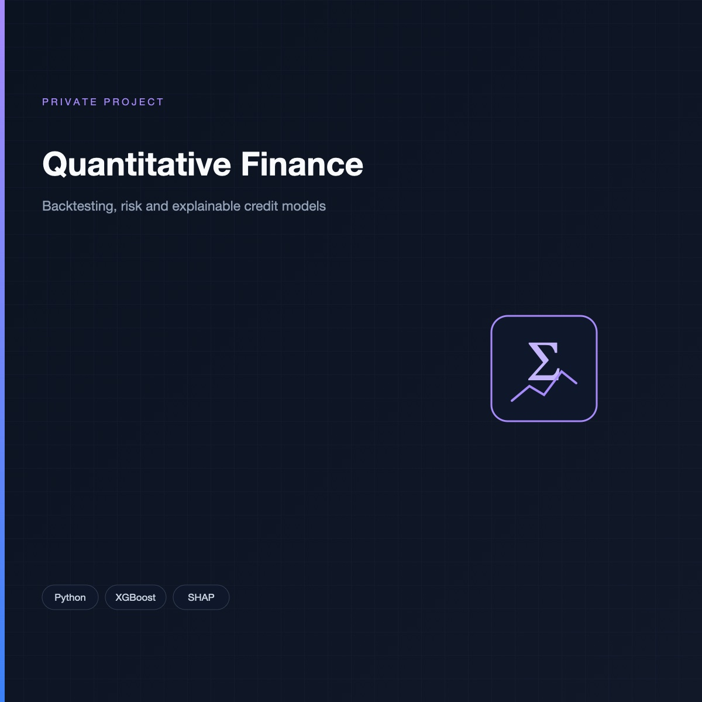
<h3>Quantitative Finance &amp; ML Research <code>Private Project</code></h3>

Finansal veriler üzerinde makine öğrenmesi, strateji simülasyonu ve risk modelleme çalışmaları.

<ul>
<li>Tarihsel piyasa verilerinin işlenmesi ve doğrulanması.</li>
<li>Backtesting, veri sızıntısı kontrolleri ve performans analizi.</li>
<li>Açıklanabilir kredi risk skorlama modelleri.</li>
</ul>

<code>Python</code> · <code>XGBoost</code> · <code>SHAP</code>

<a href="https://github.com/eniskorkut/KrediSkoruModelleme"><strong>KrediSkoruModelleme →</strong></a>

</td>
</tr>
</table>

---

## Profesyonel mühendislik deneyimim

Açık kaynak çalışmalarımın yanında kurumsal yapay zekâ sistemlerinin araştırma ve geliştirme süreçleriyle ilgileniyorum.

| Alan                   | Çalışma kapsamı                                                                                      |
| ---------------------- | ---------------------------------------------------------------------------------------------------- |
| **Enterprise RAG**     | Kurumsal dokümanlardan bilgi erişimi, hibrit retrieval, vektör arama ve kaynak temelli yanıt üretimi |
| **LLM Evaluation**     | LLM-as-a-Judge, retrieval kalitesi, otomatik değerlendirme ve insan incelemesi                       |
| **AI Observability**   | İstek izleme, gecikme analizi, token kullanımı ve hata ayıklama metrikleri                            |
| **AI Agents**          | Tool calling, MCP entegrasyonları, ajan koordinasyonu ve görev doğrulama                             |
| **Security Analytics** | SIEM log analizi, olay sınıflandırma ve güvenli veri işleme                                          |
| **Voice AI**           | Sesli asistan mimarileri, konuşma işleme ve gecikme optimizasyonu                                    |

*Bu bölüm, kurum içi kod veya hassas sistem ayrıntıları içermeyen genel mühendislik deneyimimi özetler.*

---

## Şu sıralar odaklandığım konular

- Doğrulanabilir çıktılar üreten çoklu ajan sistemleri.
- Türkçe odaklı LLM değerlendirme ve fine-tuning.
- Üretim ortamlarında RAG kalitesi ve gözlemlenebilirlik.
- Local-first AI sistemleri ve kalıcı ajan hafızası.
- Finansal veri analizi ve açıklanabilir makine öğrenmesi.

---

## GitHub Statistics

  

### Activity overview

  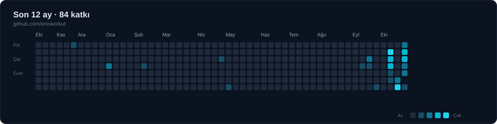

---

## İletişim

**GitHub:** [@eniskorkut](https://github.com/eniskorkut)

*Interested in building reliable, measurable and useful AI systems.*
